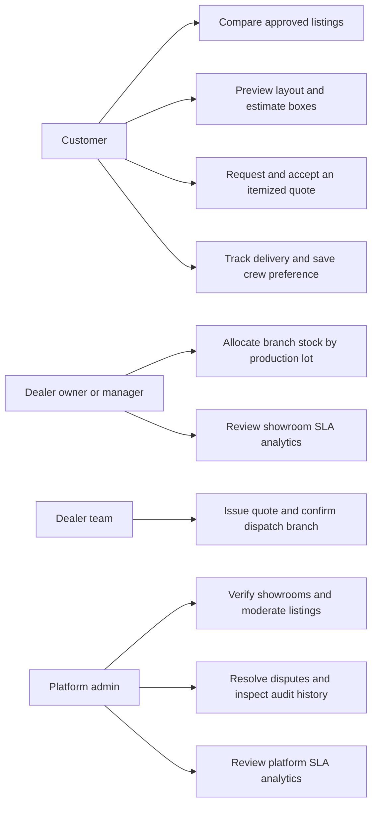
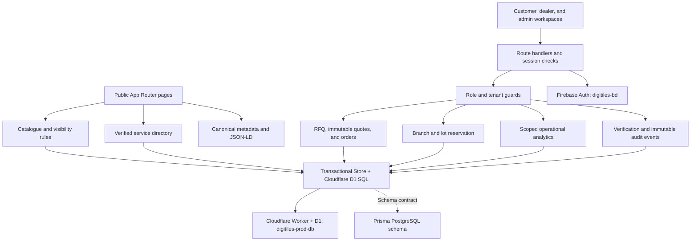
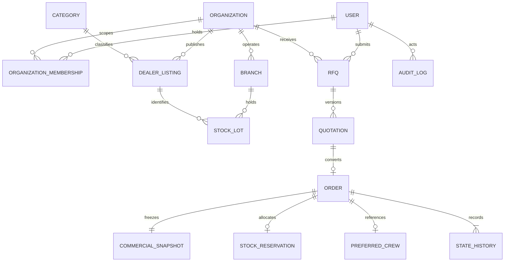
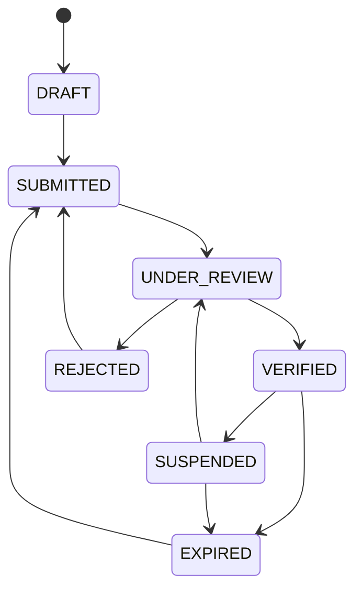
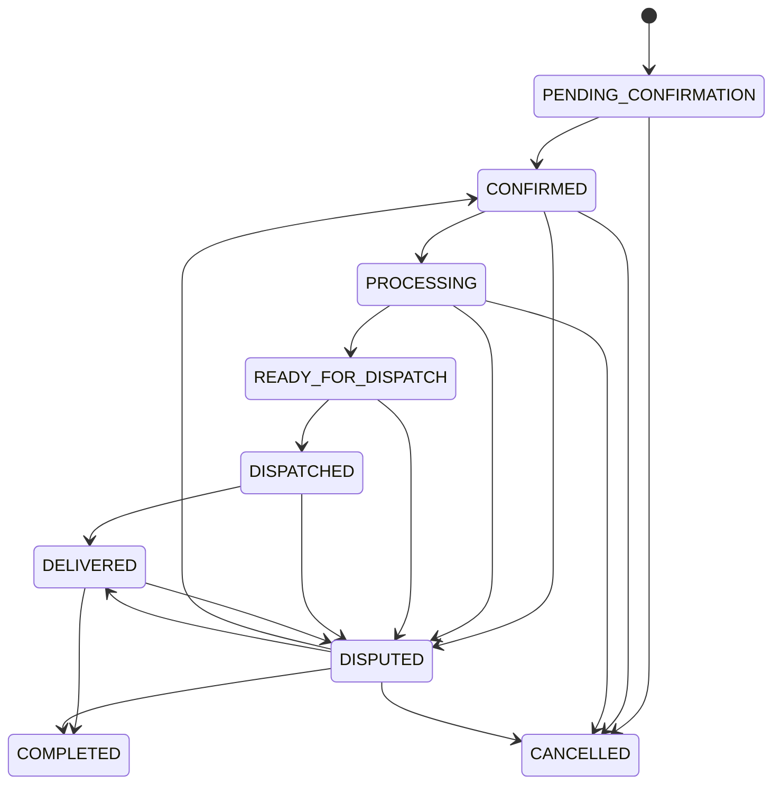
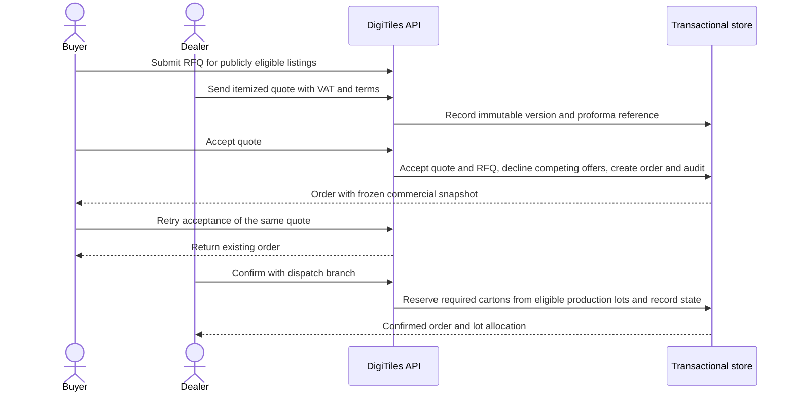

# DigiTiles

DigiTiles is a bilingual tile and construction materials marketplace for Bangladesh. Buyers compare verified showroom listings, estimate tile quantities, request itemized BDT quotes, and track delivery. Dealers manage catalogues, quotations, branch stock, and fulfilment. Platform administrators verify showrooms, moderate listings, and resolve disputes.

## Marketplace and workspaces

| Area | Routes | Workflow |
| --- | --- | --- |
| Discovery | `/`, `/marketplace`, `/marketplace/[listingId]` | Search approved listings, compare up to four technical specifications and landed price estimates, request a quote |
| Planning | `/visualizer`, `/guides`, `/guides/[slug]` | Preview four room presets in plan and perspective, adjust grout and lighting, calculate boxes with pattern-based wastage |
| Services | `/services` | Find crews by district and specialty, filter rates and project counts, and estimate material transport |
| Executive Pitch Deck | `/pitch-deck` | Interactive 12-slide 3D executive presentation (`bn`/`en`) with verbatim speech teleprompter, 3D transitions, and deep-dive financial modals |
| Identity & Auth | `/auth` | Sign in with Google or Email/Password via Firebase Authentication (`digitiles-bd`) with role-scoped workspaces |
| Customer | `/workspace/customer`, `/workspace/customer/rfqs`, `/workspace/customer/orders` | Accept quotes, print proformas and challans, track dispatch, and save an installation crew preference |
| Dealer | `/workspace/dealer`, `/workspace/dealer/organization`, `/workspace/dealer/catalogue`, `/workspace/dealer/rfqs`, `/workspace/dealer/orders` | Manage branch lots, issue immutable quotes, confirm stock and dispatch, and review SLA analytics |
| Admin | `/workspace/admin`, `/workspace/admin/orders`, `/workspace/admin/audit` | Review organization verification, moderate listings, monitor platform analytics, and audit transactions |

## Use cases



## Architecture



## Entity relationships



## Verification state machine



Public discovery and RFQs require a `VERIFIED` organization, an `ACTIVE` listing, and `APPROVED` moderation.

## Order state machine



## Quotation acceptance and branch reservation



## Local setup and verification

```powershell
npm ci
npm run dev
```

Open [the local app](http://localhost:3000). Authentication is powered by Firebase Authentication (`digitiles-bd`) with Google Sign-In and Email/Password credentials, backed by Cloudflare D1 (`digitiles-prod-db`) for relational persistence. Role-specific production credentials are documented in the local `docs/` directory (excluded from public Git history).

```powershell
npm run build
npx playwright test
```

Playwright runs against the production build with a separate seeded database. It checks the transaction and public discovery workflows, theme contrast with Axe, and search metadata. The public crawl entry points are `/robots.txt`, `/sitemap.xml`, `/llms.txt`, and `/llms-full.txt`.

## Deployment

`deploy.json` controls the release target, cloud resource bindings, and exclusion rules. The PowerShell deployment script (`./deploy.ps1`) verifies dual-CLI authentication (`wrangler` and `firebase`), builds the Next.js app, deploys the Cloudflare Worker (`digitiles-cloud-api`) and D1 database (`digitiles-prod-db`), replaces the configured GitHub branch history with one fresh commit, and deploys to Vercel Production.

```powershell
./deploy.ps1 -Message "feat: production release with Cloudflare D1, Firebase Auth and 3D Pitch Deck"
```
