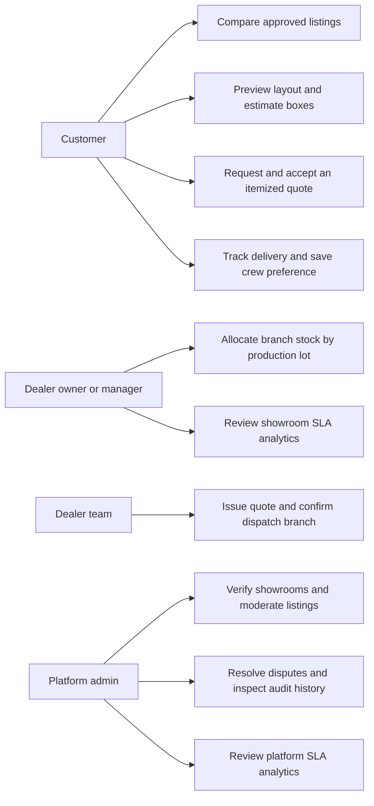
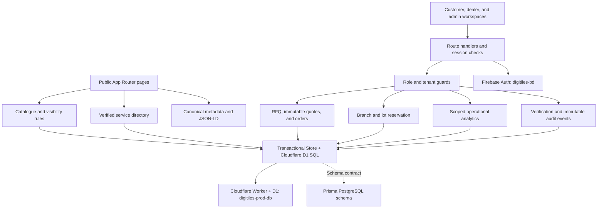
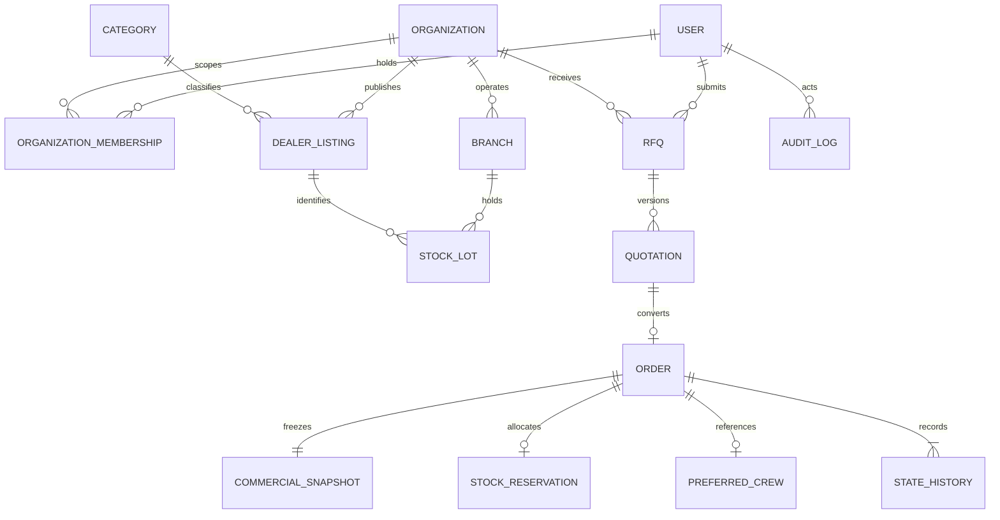
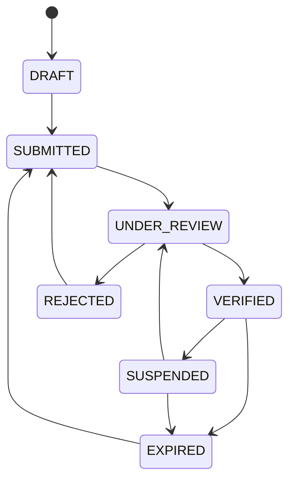
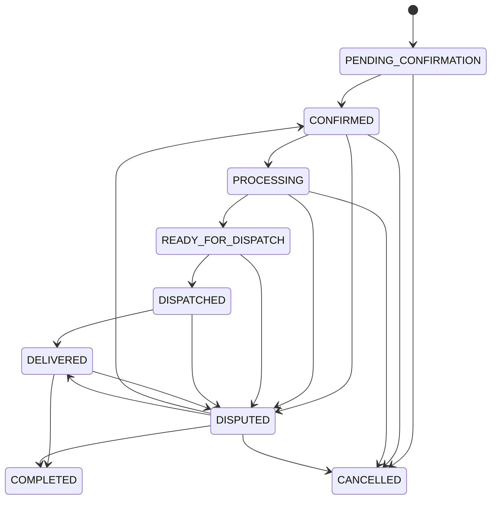
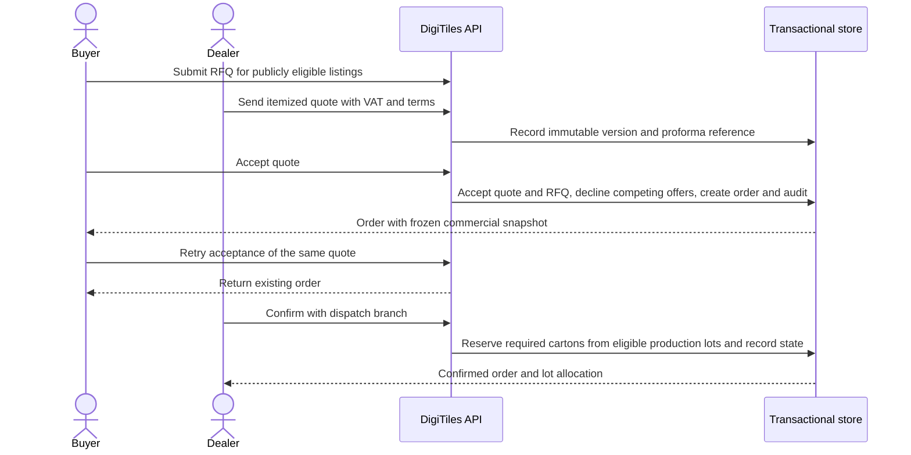

# DigiTiles

DigiTiles is a bilingual tile and construction materials marketplace for Bangladesh. Buyers compare verified showroom listings, estimate tile quantities, request itemized BDT quotes, and track delivery. Dealers manage catalogues, quotations, branch stock, and fulfilment. Platform administrators verify showrooms, moderate listings, and resolve disputes.

## Marketplace and workspaces

| Area | Routes | Workflow |
| --- | --- | --- |
| Discovery | `/`, `/marketplace`, `/marketplace/[listingId]` | Search approved listings, compare up to four technical specifications and landed price estimates, request a quote |
| Planning | `/visualizer`, `/guides`, `/guides/[slug]` | Preview four room presets in plan and perspective, adjust grout and lighting, calculate boxes with pattern-based wastage |
| Services | `/services` | Find crews by district and specialty, filter rates and project counts, and estimate material transport |
| Executive Pitch Deck | `/pitch-deck` | Interactive 12-slide 3D executive presentation (`bn`/`en`) with verbatim speech teleprompter, 3D transitions, and deep-dive financial modals |
| Live Documentation | `/docs` | YC-style pitch deck plus full technical documentation with live database metrics; admin-controlled visibility, scheduling windows, and team publishing via `/docs/admin` |
| Identity & Auth | `/auth` | Sign in with Google or Email/Password via Firebase Authentication (`digitiles-bd`) with role-scoped workspaces |
| Customer | `/workspace/customer`, `/workspace/customer/rfqs`, `/workspace/customer/orders` | Accept quotes, print proformas and challans, track dispatch, and save an installation crew preference |
| Dealer | `/workspace/dealer`, `/workspace/dealer/organization`, `/workspace/dealer/catalogue`, `/workspace/dealer/rfqs`, `/workspace/dealer/orders` | Manage branch lots, issue immutable quotes, confirm stock and dispatch, and review SLA analytics |
| Admin | `/workspace/admin`, `/workspace/admin/orders`, `/workspace/admin/audit` | Review organization verification, moderate listings, monitor platform analytics, and audit transactions |

## Use cases



## Architecture



## Entity relationships



## Verification state machine



Public discovery and RFQs require a `VERIFIED` organization, an `ACTIVE` listing, and `APPROVED` moderation.

## Order state machine



## Quotation acceptance and branch reservation



## Local setup and verification

```powershell
npm ci
npm run dev
```

Open [the local app](http://localhost:3000). Authentication is powered by Firebase Authentication (`digitiles-bd`) with Google Sign-In and Email/Password credentials, backed by Cloudflare D1 (`digitiles-prod-db`) for relational persistence. Role-specific production credentials are documented in the local `docs/` directory (excluded from public Git history).

```powershell
npm run build
npx playwright test
```

Playwright runs against the production build with a separate seeded database. It checks the transaction and public discovery workflows, theme contrast with Axe, and search metadata. The public crawl entry points are `/robots.txt`, `/sitemap.xml`, `/llms.txt`, and `/llms-full.txt`.

## Catalogue assistant and MCP suite

The public assistant at `/assistant` answers strictly from published listings, guides, and the service directory.

- Each listing is stored as contextualized semantic chunks: full record, specification section, and pricing section. Guides split into introduction, steps, and FAQs.
- A listing hit expands across the verified showroom's other listings. Retrieval fuses bilingual `bn`/`en` synonym expansion with `@cf/baai/bge-base-en-v1.5` embeddings.
- Incoming queries are pre-screened via the edge MCP tool `screen_prompt_safety` (`@cf/meta/llama-guard-3-8b`), and answers are generated by `@cf/meta/llama-3.2-3b-instruct` with Google Gemini Flash fallback.

### Built MCP Servers (5 Servers, Streamable HTTP & stdio)

Declared in `.mcp.json` and runnable over `stdio` (`npm run mcp:stdio -- --server <name>`) or live over `Streamable HTTP`:

| Server | Streamable HTTP Endpoint | Tools |
| --- | --- | --- |
| `digitiles-catalogue-mcp` | `https://digitiles.equisaas-bd.com/mcp` | `search_catalogue`, `get_listing_specs` |
| `digitiles-estimator-mcp` | `https://digitiles.equisaas-bd.com/mcp/estimator` | `calculate_tile_boxes`, `compare_laying_patterns` |
| `digitiles-services-mcp` | `https://digitiles.equisaas-bd.com/mcp/services` | `find_installation_crews`, `estimate_transport_fare` |
| `digitiles-governance-mcp` | `https://digitiles.equisaas-bd.com/mcp/governance` | `get_marketplace_metrics`, `inspect_state_machine` |
| `digitiles-d1-telemetry-mcp` | `https://api.digitiles.equisaas-bd.com/mcp` | `get_d1_health`, `list_d1_tables`, `screen_prompt_safety` |

Live status across all 5 built and 5 third-party used MCP servers (`firebase-mcp-server`, `cloudflare-docs-mcp`, `context7`, `chrome-devtools-mcp`, `sequential-thinking`) is exposed at `GET /api/mcp/status`.

## Deployment

The public hostnames stay on the Cloudflare account that owns `equisaas-bd.com`. They forward to the workers on account `f097993c07d8490e4744dfeac7519066`:

- `https://digitiles.equisaas-bd.com` forwards to `digitiles-web`
- `https://api.digitiles.equisaas-bd.com` forwards to `digitiles-cloud-api`

`deploy.json` names that account, the D1 database `digitiles-prod-db`, and the KV namespace `DIGITILES_KV`. `./deploy.ps1` checks the Wrangler login and the Firebase login, builds the site, deploys the API worker, replaces GitHub `main` with one new commit, and deploys the web worker. `deploy.ps1` itself is not committed.

```powershell
./deploy.ps1 -Message "feat: DigiTiles Production Platform with Cloudflare D1, Firebase Auth and 3D Executive Pitch Deck"
```
